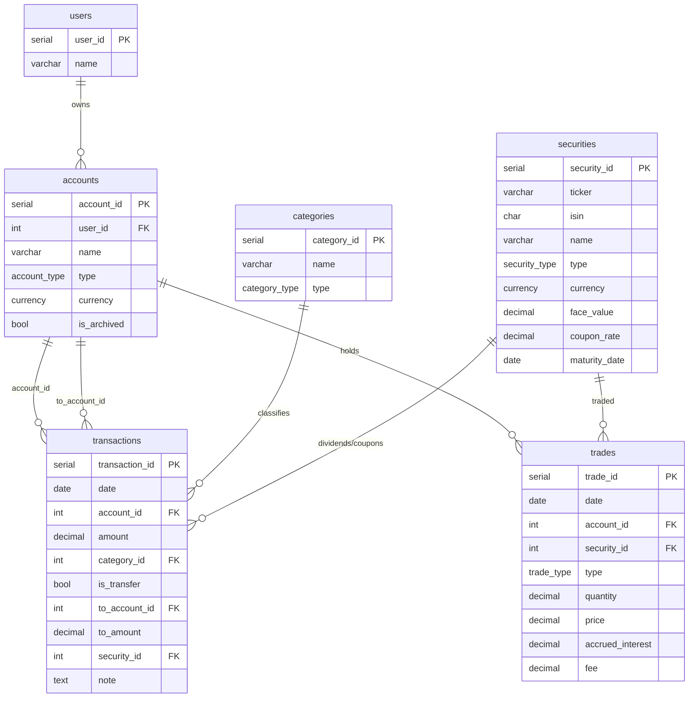

# База данных

Postgres 16, поднимается через `docker-compose.yml`. Схема создаётся init-скриптами в `db/init/`, применяются в алфавитном порядке при первом старте контейнера (том `pg-data` пустой).

## Запуск

```bash
cp .env.example .env   # выставить POSTGRES_USER / POSTGRES_PASSWORD / POSTGRES_DB / POSTGRES_PORT
docker compose up -d
```

Healthcheck: `pg_isready -U $POSTGRES_USER -d $POSTGRES_DB`.

Пересоздать схему с нуля (init-скрипты не переигрываются, пока том жив):

```bash
docker compose down -v   # удаляет volume pg-data
docker compose up -d
```

## Файлы инициализации

| Файл                  | Назначение                                                                            |
| --------------------- | ------------------------------------------------------------------------------------- |
| `01_enums.sql`        | ENUM-типы: `currency`, `account_type`, `category_type`, `security_type`, `trade_type` |
| `02_users.sql`        | таблица `users`                                                                       |
| `03_accounts.sql`     | таблица `accounts`                                                                    |
| `04_categories.sql`   | таблица `categories`                                                                  |
| `05_sequrities.sql`   | таблица `securities`                                                                  |
| `06_transactions.sql` | таблица `transactions`                                                                |
| `07_trades.sql`       | таблица `trades`                                                                      |
| `08_seed.sql`         | тестовые данные                                                                       |

Подробное описание таблиц и связей — [`schema.md`](./schema.md).

Веб-интерфейс для БД (pgAdmin) — [`pgadmin.md`](./pgadmin.md).

Работа с БД из кода (Kysely, `@fms/db`, миграции) — [`kysely.md`](./kysely.md).

## ER-диаграмма



## Ключевые решения

- **Одна таблица `transactions` для расходов/доходов и переводов**, различаются флагом `is_transfer` — см. constraint `chk_transfer_or_category` в [schema.md](./schema.md#transactions). Это позволяет строить единую ленту операций без UNION.
- **Дивиденды и купоны** — обычные строки `transactions` с заполненным `security_id`, а не отдельная сущность. Категория (`Дивиденды`/`Купоны`) определяет тип дохода, `security_id` — источник.
- **`trades` не трогает баланс счёта напрямую** — движение денег по сделке (списание/зачисление на брокерском счету) в текущей схеме не отражается отдельной транзакцией; баланс брокерского счёта в рублях/валюте и позиции по бумагам нужно считать агрегацией по `trades` + `transactions`, если это понадобится агенту.
